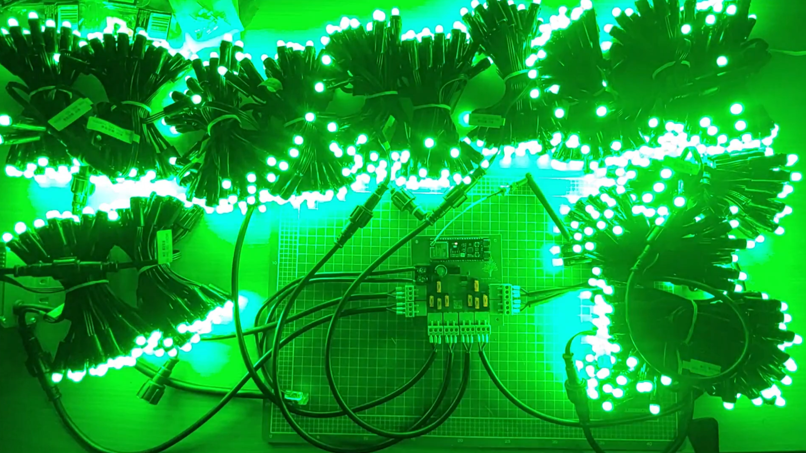
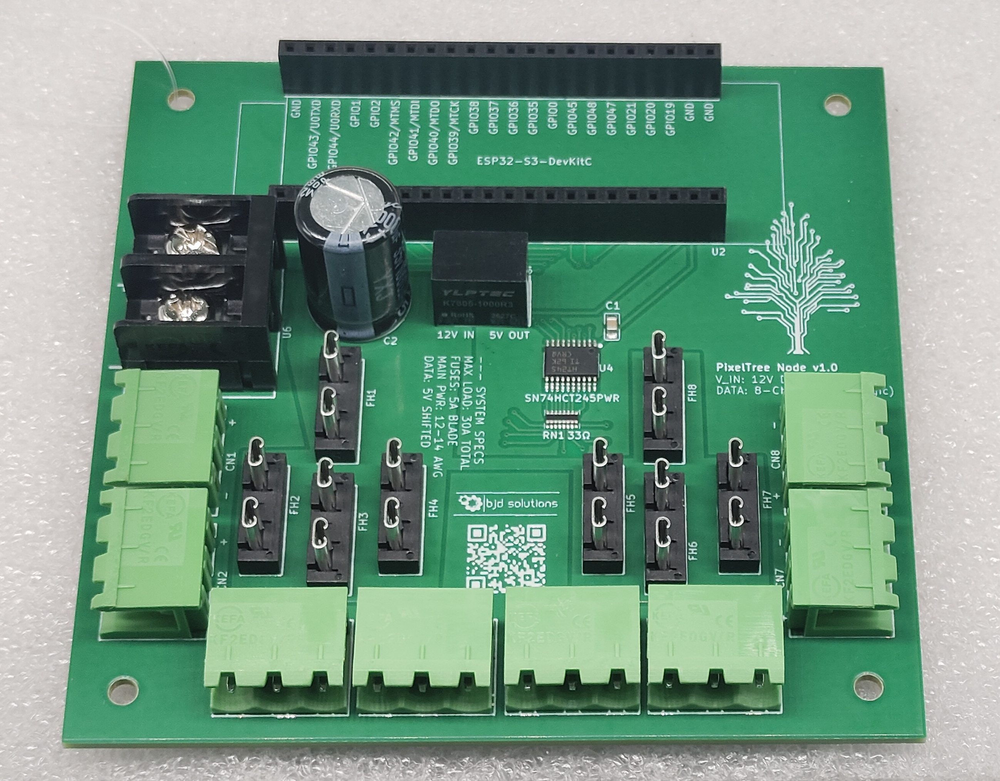
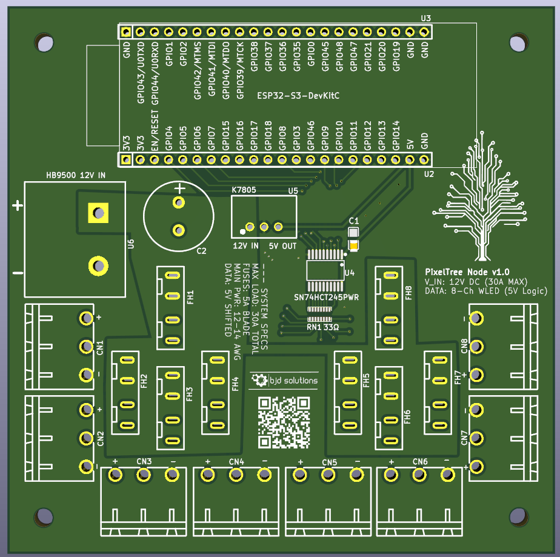
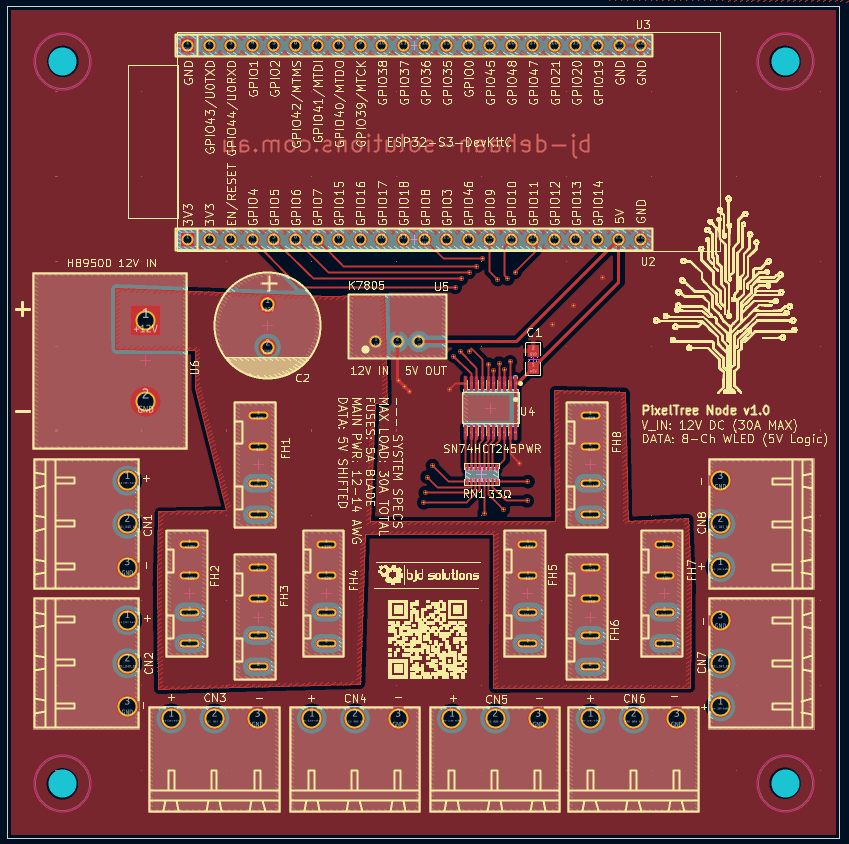
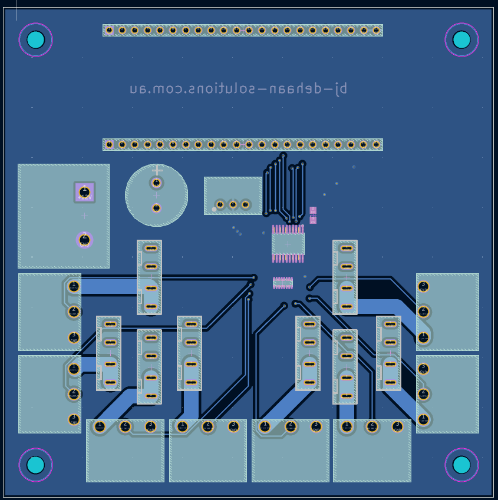
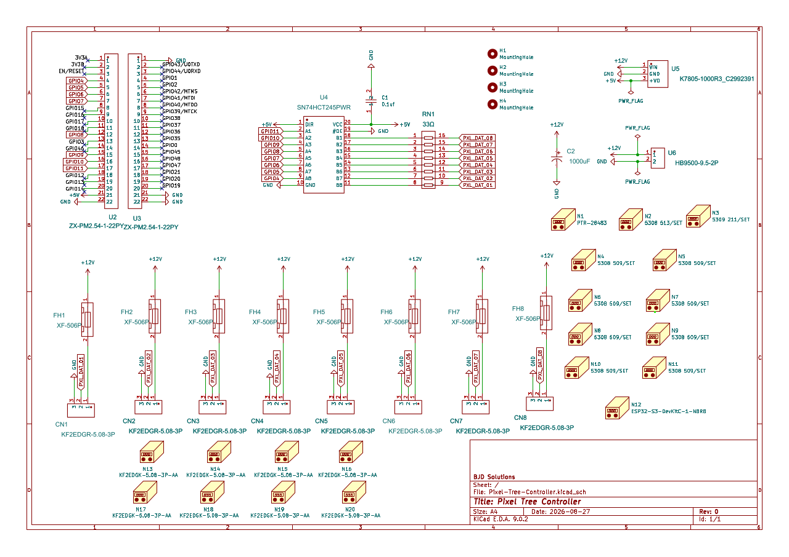

# 🎄 PixelTree Node: High-Current ESP32 WLED Controller

**A robust, logic-shifted, and fused Power Distribution Hub for driving massive addressable LED arrays (up to 22A) with an ESP32-S3 and WLED.**

 

---

## 📖 Overview

Driving 800 WS2811 pixels at full brightness draws upwards of 16 Amps (192 Watts). Attempting to route this through breadboards, thin jumper wires, or standard microcontrollers results in melted plastic, ground loops, erratic flickering, and potential fire hazards. Furthermore, the ESP32 outputs a 3.3V logic signal, while WS2811 pixels strictly require 5V, leading to degraded data packets over long wire runs.

The **PixelTree Node v1.0** solves this. It is a custom-engineered PCB that acts as a safe, isolated, high-current brain for outdoor holiday light shows. It takes a massive 12V payload, distributes it safely across 8 automotive-fused branches, steps down power for an onboard ESP32-S3, and flawlessly level-shifts 8 data channels to 5V.

---

## 📸 Hardware Gallery

 
| Assembled Board | 3D Render |
| :---: | :---: |
|  |  |

| PCB Front | PCB Back |
| :---: | :---: |
|  |  |

<b>Click to view Schematic</b>

 

---

## ✨ Key Features

*   **Massive Power Handling**: Designed with heavy copper polygon pours and 3.0mm output traces. Safely distributes up to 22A of 12V DC power.
*   **Flawless Logic Shifting**: Utilizes an onboard `SN74HCT245` chip to cleanly shift the ESP32's 3.3V data signals up to a punchy 5V, ensuring zero data degradation over long pigtails.
*   **Integrated Voltage Step-Down**: An onboard `K7805` highly-efficient buck converter drops 12V down to a stable 5V for the microcontroller and logic chip, eliminating the need for dual power supplies.
*   **Independent Automotive Fusing**: 8 individual output channels are protected by standard Mini Blade Fuses (e.g., 5A). If a wire shorts outdoors, the 50-cent fuse pops, protecting your display.
*   **Common Ground Architecture**: Front and back solid copper ground planes provide a rock-solid electrical reference point, completely eliminating erratic LED flickering caused by ground loops.
*   **Plug-and-Play WLED Integration**: Designed specifically around the ESP32-S3 footprint with 8 dedicated hardware output pins perfectly suited for WLED's 2D Matrix capabilities.

---

## 🏗️ Architecture & Tech Stack

| Component / Tool | Details |
| :--- | :--- |
| **EDA Software** | KiCad (Designed using standard 1.6mm FR4 / 1oz Copper limits) |
| **Microcontroller** | `ESP32-S3-DevKitC-1U-N8R8` (Wi-Fi, Dual Core, RMT Peripheral for LEDs) |
| **Logic Shifter** | `SN74HCT245PWR` (8-Channel Octal Bus Transceiver) |
| **Buck Converter** | `K7805-1000R3` (12V in, 5V out, High Efficiency) |
| **Terminals** | `HB9500-9.5-2P` (Main Input) & `KF2EDGR-5.08-3P` (xConnect Pigtail Outputs) |
| **Firmware** | WLED (Web UI, E1.31 / DDP support, Pixel Art Matrix support) |

---

## 🚀 Quick Start & Manufacturing

### 1. Fabricating the Board
This project relies on high-current traces and surface-mount (SMD) components. We highly recommend utilizing a turnkey assembly service.

1. Download the [Latest Release Zip](Pixel-Tree-Controller.kicad_pcb.zip).

### 2. Software Installation (WLED)
1. Plug your `ESP32-S3` into your computer via USB.
2. Navigate to [install.wled.me](https://install.wled.me/) using a Web Serial compatible browser (Chrome/Edge).
3. Flash the latest stable release and configure your Wi-Fi credentials.
4. Insert the ESP32 into the completed PCB (ensure the board is **powered off** before inserting the microcontroller).

---

## ⚙️ WLED Configuration & Pin Mapping

This board relies on **Serpentine Wiring (Folding)**. Each of the 8 ports drives two 50-pixel strings connected end-to-end (100 pixels per port). Because we use 12V WS2811 pixels, the voltage drop is minimal, and power injection at the 100th pixel is not required.

### Output Port Mapping

| PCB Port | ESP32 GPIO | Pixels Driven | WLED Matrix Role |
| :---: | :---: | :---: | :--- |
| **CN1** | `GPIO 4` | 0 - 99 | Strands 1 (UP) & 2 (DOWN) |
| **CN2** | `GPIO 5` | 100 - 199 | Strands 3 (UP) & 4 (DOWN) |
| **CN3** | `GPIO 6` | 200 - 299 | Strands 5 (UP) & 6 (DOWN) |
| **CN4** | `GPIO 7` | 300 - 399 | Strands 7 (UP) & 8 (DOWN) |
| **CN5** | `GPIO 8` | 400 - 499 | Strands 9 (UP) & 10 (DOWN) |
| **CN6** | `GPIO 9` | 500 - 599 | Strands 11 (UP) & 12 (DOWN) |
| **CN7** | `GPIO 10` | 600 - 699 | Strands 13 (UP) & 14 (DOWN) |
| **CN8** | `GPIO 11` | 700 - 799 | Strands 15 (UP) & 16 (DOWN) |

---

## ⚠️ Safety Warnings & "The Multimeter Trap"

> **IMPORTANT:** When probing this newly assembled board for shorts using a cheap multimeter in "Continuity" mode, it may beep continuously between 12V and GND. **Do not panic.** Cheap multimeters beep for anything under 1,000 Ohms.
>
> If you switch to **Resistance (Ohms)** mode, you will likely read ~600 Ω from 12V to GND. This is a 20mA draw—merely the resting resistance of the `K7805` buck converter. A true dead short (solder bridge) will read between 0 Ω and 1.5 Ω.

*   **Always apply 12V power *without* the ESP32 inserted first.** Probe the 5V socket pins to ensure the buck converter is functioning correctly. If it has failed and is passing 12V, it will instantly destroy your ESP32.
*   **Never insert or remove the ESP32 while the board is powered.**
*   Always use appropriately rated automotive fuses (e.g., 5A) for each channel to protect against outdoor shorts.

---

## 🤝 Contributing

Contributions, issues, and feature requests are welcome!

If you want to contribute to the KiCad schematic or routing:
1. Fork the Project.
2. Create your Feature Branch (`git checkout -b feature/AmazingFeature`).
3. Commit your Changes (`git commit -m 'Add some AmazingFeature'`).
4. Push to the Branch (`git push origin feature/AmazingFeature`).
5. Open a Pull Request.

---

## 📝 License

Distributed under the CERN Open Hardware License Version 2 - Permissive.

> Designed by **BJD Solutions** 